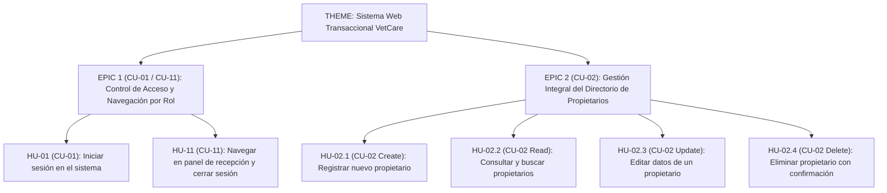
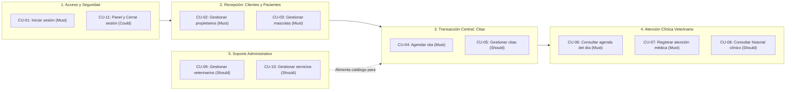

# Proyecto Bimestre 1: VetCare — Documentación de Ingeniería de Requisitos y Arquitectura Base (Integrante 1)

**Sistema web de gestión de citas y pacientes para la clínica veterinaria "Huellitas"**

* **Asignatura:** Desarrollo de Aplicaciones Web
* **Metodología de Referencia:** Extreme Programming (XP) — *User Stories (3 C's: Card, Conversation, Confirmation), Criterios INVEST, User Story Mapping y Planning Game* + Especificación de Casos de Uso y Priorización MoSCoW.
* **Responsable de este entregable:** **Anthony (Integrante 1)** — *Arquitectura Base, CSS Global, Acceso (Login) y Módulo de Propietarios*.
* **Equipo del Proyecto (Grupo de 3 Integrantes):**
  1. **Anthony (Integrante 1):** Visión (3.1), Requisitos y Tarjetas de Usuario de Acceso y Propietarios `CU-01`, `CU-02`, `CU-11` (3.2), Priorización MoSCoW (3.4), Arquitectura CSS Global (`css/style.css`) y 6 pantallas HTML5.
  2. **Maria (Integrante 2):** Requisitos de Mascotas, Atención Médica e Historial Clínico `CU-03`, `CU-07`, `CU-08` (3.2), Diagrama UML 2.5 (3.3), Diccionario de Datos Ficticios y 7 pantallas HTML5.
  3. **Nayia (Integrante 3):** Requisitos de Citas, Agenda y Administración `CU-04`, `CU-05`, `CU-06`, `CU-09`, `CU-10` (3.2), Mapa Navegacional (3.5), Validación W3C, Compilación PDF, Despliegue en GitHub Pages y 9 pantallas HTML5.
* **Fecha límite de entrega:** Miércoles 18 de noviembre de 2026 (23:59).

---

## 3.1. Documento de Visión (Theme del Producto)

### 1. Planteamiento del Problema
La clínica veterinaria **"Huellitas"**, ubicada en la ciudad de Quito, atiende un promedio de **40 mascotas diarias** contando con un equipo operativo conformado por **tres médicos veterinarios**, **una recepcionista** y un **administrador**. En la actualidad, la totalidad de los procesos transaccionales y clínicos se ejecuta de manera manual:
* Las citas médicas se solicitan telefónicamente o en ventanilla y se anotan a mano en un cuaderno físico.
* Los datos personales y de contacto de los propietarios se registran manualmente en hojas sueltas o libretas sin validación de formato.
* El historial médico de cada paciente (diagnósticos, pesos y tratamientos previos) se archiva en fichas de papel dispersas.

**¿A quién afecta y cuál es su impacto?**
1. **A la Recepcionista:** Sufre sobrecarga operativa al buscar fichas físicas, comete errores involuntarios al transcribir números de cédula o teléfonos celulares incompletos, registra mascotas por duplicado y asigna citas superpuestas al mismo veterinario en el mismo bloque horario.
2. **A los Veterinarios:** Atienden pacientes a ciegas sin contar de forma inmediata con el historial clínico previo (alergias, evolución de peso, diagnósticos anteriores), lo que compromete la calidad y seguridad del diagnóstico médico y retrasa el flujo diario de la agenda.
3. **A los Propietarios y Pacientes (Mascotas):** Experimentan tiempos de espera prolongados en sala, reprogramaciones forzosas por cruces de horario y falta de seguimiento oportuno por números de contacto mal escritos.
4. **A la Administración de la Clínica:** Carece de un control estandarizado y actualizado sobre el catálogo de servicios veterinarios, sus tarifas oficiales y la disponibilidad de especialidades del personal médico.

---

### 2. Niveles de Requisitos del Sistema (Enfoque Ingeniería de Requisitos)
Siguiendo los estándares de Ingeniería de Requisitos (IEEE Std. 610.12-1990) y XP, las necesidades de la clínica "Huellitas" se estructuran en cuatro niveles:

| Nivel de Requisito | Definición en el Contexto de VetCare |
| :--- | :--- |
| **R1. Nivel de Negocio** | Eliminar el extravío de información clínica, la duplicidad de registros y los cruces de horario en la clínica "Huellitas", optimizando la atención diaria de las ~40 mascotas mediante la digitalización estandarizada de sus flujos operativos. |
| **R2. Nivel Usuario / Dominio** | Permitir a la recepción gestionar el directorio de propietarios, sus mascotas y el agendamiento de citas; al cuerpo médico consultar su agenda diaria y documentar atenciones clínicas; y a la administración mantener el catálogo de veterinarios y servicios. |
| **R3. Nivel Software (Funcional)** | Proveer interfaces transaccionales CRUD (Crear, Leer, Actualizar y Eliminar) con validación nativa de reglas de negocio (cédula de 10 dígitos, celular `09XXXXXXXX`, pesos entre 0,1 y 120 kg, citas en bloques de 30 minutos de lunes a sábado de 08:00 a 18:00 y servicios entre \$1,00 y \$500,00). |
| **R4. Nivel Software (No Funcional)** | Construir el sistema exclusivamente con **HTML5 semántico** y **CSS/CSS3 puro** (sin JavaScript ni frameworks CSS), garantizando compatibilidad idéntica en Google Chrome y Mozilla Firefox, validación W3C sin errores, diseño adaptable (*responsive*) en móvil y escritorio, y nivel de contraste **AA de WCAG**. |

---

### 3. Interesados (Stakeholders) y Usuarios del Sistema

| Interesado / Rol | Tipo | ¿Qué necesita del sistema? (Objetivos centrados en el usuario) | Responsabilidad dentro de VetCare |
| :--- | :--- | :--- | :--- |
| **Recepcionista** | Usuario directo (Operativo) | Agilidad para buscar propietarios por cédula o nombre, registrar sus mascotas sin duplicados y agendar, reprogramar o cancelar citas verificando horarios válidos. | Ejecutar los módulos CRUD de **Propietarios** (`CU-02`), **Mascotas** (`CU-03`), **Agendar cita** (`CU-04`) y **Gestionar citas** (`CU-05`). |
| **Veterinario** | Usuario directo (Clínico) | Visualizar de forma ordenada sus citas programadas del día, consultar el historial médico completo de cada mascota antes de atenderla y registrar el diagnóstico, tratamiento y peso actualizado. | Consultar la **Agenda del día** (`CU-06`), **Registrar atención médica** (`CU-07`) cambiando el estado de la cita a *Atendida*, y **Consultar historial clínico** (`CU-08`). |
| **Administrador** | Usuario directo (Gestión) | Mantener actualizada la nómina de médicos veterinarios activos y el catálogo oficial de servicios médicos con sus precios vigentes. | Ejecutar los módulos CRUD de **Veterinarios** (`CU-09`) y **Servicios** (`CU-10`). |
| **Propietario de Mascota** | Interesado indirecto (Beneficiario) | Recibir atención puntual sin pérdida de la ficha médica de su mascota ni errores en sus datos de contacto. | Proporcionar sus datos personales y los de su mascota en recepción al solicitar una cita. |
| **Gerencia Clínica "Huellitas"** | Interesado de negocio (Cliente XP) | Garantizar el orden transaccional, la integridad de datos desde el formulario de entrada y la trazabilidad de las ~40 atenciones diarias. | Definir las reglas de negocio, priorizar las historias de usuario y validar los criterios de aceptación. |

---

### 4. Objetivo del Sistema
Desarrollar **VetCare**, una aplicación web transaccional estática e intuitiva construida con HTML5 semántico y CSS3 puro que centralice y valide en tiempo de captura las operaciones CRUD de propietarios, mascotas, citas médicas, atenciones clínicas, veterinarios y servicios de la clínica veterinaria **"Huellitas"**, erradicando el uso de cuadernos y fichas de papel.

---

### 5. Alcance del Sistema (Scope)

#### ¿Qué incluye esta versión (In-Scope — Bimestre 1)?
1. **Módulo de Acceso por Rol (`CU-01`, `CU-11`):** Pantalla de inicio de sesión con validación de correo y contraseña, y navegación hacia los paneles de Recepcionista, Veterinario y Administrador, incluyendo el cierre de sesión.
2. **Módulo CRUD de Propietarios (`CU-02`):** Listado con buscador (`type="search"`), formulario de creación con validación estricta de cédula ecuatoriana, celular y nombres, formulario de edición precargado y pantalla de confirmación de eliminación.
3. **Módulo CRUD de Mascotas (`CU-03`):** Gestión completa de pacientes asociados a un único propietario existente, validando especie, raza sugerida con `datalist`, sexo, fecha de nacimiento no futura y peso en kilogramos.
4. **Módulo Transaccional de Citas (`CU-04`, `CU-05`):** Agendamiento de nuevas citas asociando mascota, servicio, veterinario, fecha y hora (bloques de 30 minutos de lunes a sábado de 08:00 a 18:00), así como listado, reprogramación y cancelación con motivo obligatorio.
5. **Módulo Clínico y de Agenda (`CU-06`, `CU-07`, `CU-08`):** Consulta de agenda diaria del veterinario, formulario de registro de atención médica (diagnóstico, tratamiento, peso y transición a estado *Atendida*) y vista cronológica más detalle del historial clínico por mascota.
6. **Módulo Administrativo (`CU-09`, `CU-10`):** Gestión CRUD del personal veterinario y del catálogo de servicios con validación de precios entre \$1,00 y \$500,00.

#### ¿Qué queda fuera de esta versión (Out-of-Scope)?
* Persistencia real en base de datos o procesamiento en servidor (*backend*), dado que el alcance del Primer Bimestre evalúa arquitectura front-end estática y validación nativa HTML5.
* Pasarelas de pago en línea, facturación electrónica (SRI) o cobros con tarjeta.
* Envío automatizado de notificaciones por correo electrónico, SMS o WhatsApp.
* Gestión de inventario de farmacia/bodega u hospitalización con internamiento continuo.

---

### 6. Características Principales del Sistema (Features de Alto Nivel)
1. **F-01. Control de Acceso Unificado y Enrutamiento por Rol:** Punto de entrada único (`index.html`) con validación de credenciales y acceso estructurado a las vistas operativas de Recepción, Veterinaria y Administración.
2. **F-02. Directorio Validado de Propietarios:** Registro, búsqueda, actualización y baja lógica/física simulada de dueños de mascotas con control de formato para cédula (10 dígitos) y celular (`09XXXXXXXX`).
3. **F-03. Censo Clínico de Mascotas por Propietario:** Vinculación unívoca de cada mascota con su dueño, categorización por especie y sugerencia de razas mediante controles nativos `datalist`.
4. **F-04. Motor Estático de Agendamiento de Citas:** Programación de turnos médicos restringida a horarios laborales (lunes a sábado, 08:00–18:00, intervalos de 1800 segundos / 30 min) evitando fechas pasadas.
5. **F-05. Gestión de Estados y Reprogramación de Citas:** Control del ciclo de vida de la cita (*Programada*, *Atendida*, *Cancelada*) exigiendo justificación documentada (máx. 200 caracteres) en toda cancelación.
6. **F-06. Panel de Agenda Médica Diaria:** Vista filtrable por fecha y estado para que cada veterinario identifique de inmediato su carga de trabajo del día e inicie la consulta con un clic.
7. **F-07. Registro Estructurado de Atención Médica:** Captura de signos vitales (peso actualizado, temperatura/observaciones), diagnóstico presuntivo/definitivo y receta/tratamiento vinculado a la cita.
8. **F-08. Expediente e Historial Clínico Centralizado:** Consulta cronológica de todas las atenciones previas de una mascota con acceso al detalle completo de cada intervención médica.
9. **F-09. Administración de Personal Médico y Especialidades:** Mantenimiento del directorio de veterinarios habilitados para atender consultas en la clínica.
10. **F-10. Catálogo Tarifario de Servicios Veterinarios:** Gestión de prestaciones médicas con nombres únicos y precios controlados en el rango de \$1,00 a \$500,00.

---

### 7. Restricciones y Supuestos

#### Restricciones Técnicas
* **RT-01 (Exclusividad HTML5 y CSS3):** Está estrictamente prohibido el uso de JavaScript (`<script>`, eventos inline `onclick`, etc.) y de frameworks o librerías CSS externas (Bootstrap, Tailwind, Bulma, Foundation).
* **RT-02 (Prohibición de estilos en línea):** Ningún archivo `.html` puede contener el atributo `style="..."` ni etiquetas `<style>`; todo el diseño debe residir en `css/style.css`.
* **RT-03 (Simulación CRUD Estática):**
  * *Create:* Formulario vacío con validación HTML5 cuyo atributo `action` dirige al listado correspondiente solo si todos los campos son válidos (sin `novalidate`).
  * *Read:* Tabla semántica (`caption`, `thead`, `tbody`, `th scope`) con registros de ejemplo coherentes, buscador `type="search"` y acciones de navegación.
  * *Update:* Formulario precargado mediante atributos `value`, `selected` y `checked` con los datos del registro oficial de prueba.
  * *Delete:* Pantalla dedicada de confirmación que exhibe los datos del registro a eliminar junto con los controles *"Confirmar eliminación"* y *"Cancelar"*.
* **RT-04 (Calidad y Accesibilidad W3C / WCAG):** El código debe aprobar con **0 errores** los validadores oficiales de la W3C (HTML y CSS), cumplir contraste mínimo **AA de WCAG** y renderizar de forma idéntica en **Google Chrome** y **Mozilla Firefox**.

#### Restricciones de Negocio
* **RN-01 (Cédula):** Obligatoria, compuesta exactamente por 10 dígitos numéricos (`pattern="[0-9]{10}"`).
* **RN-02 (Teléfono Celular):** Obligatorio, 10 dígitos numéricos que inician obligatoriamente con `09` (`pattern="09[0-9]{8}"`).
* **RN-03 (Nombres y Apellidos):** Obligatorios, compuestos únicamente por letras (incluyendo tildes y `ñ`) y espacios, con longitud entre 2 y 50 caracteres.
* **RN-04 (Relación Propietario–Mascota):** Toda mascota pertenece exactamente a un propietario registrado; su especie se restringe a *Perro, Gato, Ave, Roedor u Otro*, su peso oscila entre `0.1` y `120` kg (`step="0.1"`) y su fecha de nacimiento no puede superar la fecha actual.
* **RN-05 (Horario de Citas):** Solo de lunes a sábado, entre las `08:00` y las `18:00`, en bloques exactos de 30 minutos (`step="1800"`), sin permitir fechas anteriores al día actual.
* **RN-06 (Estados de Cita):** Toda cita nace como *Programada* y finaliza como *Atendida* o *Cancelada* (esta última exige un motivo de hasta 200 caracteres).
* **RN-07 (Catálogo de Servicios):** Nombre único de servicio y precio entre `$1.00` y `$500.00` (`min="1.00"`, `max="500.00"`, `step="0.01"`).

#### Supuestos del Proyecto
* **SP-01:** La clínica "Huellitas" dispone de equipos de escritorio en recepción y consultorios, así como tabletas/móviles con navegadores Chrome o Firefox actualizados.
* **SP-02:** Los tres integrantes del equipo comparten un único **Diccionario de Datos Ficticios Oficial** (p. ej., el propietario *Juan Carlos Pérez Morales* con cédula `1712345678` y su mascota *Toby*) para preservar la coherencia referencial entre todas las pantallas estáticas.

---

### 8. Glosario de Términos del Dominio

| Término | Definición en el Dominio de la Clínica "Huellitas" |
| :--- | :--- |
| **Propietario** | Persona mayor de edad responsable legal y económicamente de una o varias mascotas atendidas en la clínica, identificada de manera única por su número de cédula de 10 dígitos. |
| **Mascota (Paciente)** | Animal doméstico (*Perro, Gato, Ave, Roedor u Otro*) registrado bajo la tutela de un único propietario y sujeto de atención médica veterinaria. |
| **Cita Médica** | Reserva programada en una fecha y bloque horario específico (30 minutos) que vincula a una mascota, un servicio veterinario y un médico veterinario responsable. |
| **Estado de la Cita** | Condición operativa de una reserva dentro de su ciclo de vida: **Programada** (pendiente de atención), **Atendida** (consulta médica concluida) o **Cancelada** (anulada previa justificación). |
| **Agenda del Día** | Cronograma diario personalizado de un médico veterinario que lista todas sus citas asignadas para una fecha determinada ordenadas por hora. |
| **Atención Médica** | Acto clínico ejecutado por el veterinario durante una cita en el cual se evalúa al paciente, se registra su peso actual, diagnóstico y tratamiento prescrito, pasando la cita al estado *Atendida*. |
| **Historial Clínico** | Expediente médico acumulativo e inmutable de una mascota que reúne en orden cronológico todas las atenciones médicas, diagnósticos, pesos y tratamientos que ha recibido en la clínica. |
| **Servicio Veterinario** | Prestación médica o asistencial ofrecida por la clínica (ej. *Consulta General, Vacunación Polivalente, Desparasitación, Cirugía Menor, Ecografía*) con una tarifa oficial entre \$1,00 y \$500,00. |
| **Operación CRUD Estática** | Representación navegacional de las cuatro operaciones persistentes (*Create, Read, Update, Delete*) mediante formularios HTML5 con validación nativa, tablas con datos coherentes y pantallas de confirmación. |

---

## 3.2. Especificación de Requisitos — Módulo del Integrante 1 (Tarjetas XP + Casos de Uso)

Siguiendo la metodología **Extreme Programming (XP)** del curso, los requisitos de este módulo se estructuran jerárquicamente desde **Epics** hacia **User Stories** atómicas que cumplen los atributos **INVEST** (*Independent, Negotiable, Valuable, Estimatable, Small, Testable*).

Cada historia se documenta combinando:
1. **La Tarjeta XP (3 C's: *Card, Conversation, Confirmation*)** con criterios de aceptación orientados a escenarios (**Dado / Cuando / Entonces** — *Given / When / Then*).
2. **La Ficha Técnica del Caso de Uso** exigida por la rúbrica del proyecto (Precondiciones, Flujo básico, Flujos alternos, Postcondiciones, Controles HTML5 y Pantallas `.html`).

### Mapa de Refinamiento del Módulo 1 (De Epics a Stories y Tasks)

---

### TARJETA 1: `HU-01` / `CU-01` — Iniciar sesión en el sistema

| **ID:** `CU-01` / `HU-01` | **Title:** Inicio de sesión por rol de usuario | **Priority:** `Must` (Valor: 5/5) | **Estimate:** 2 puntos (2 h ideales) |
| :--- | :--- | :--- | :--- |
| **User Story (Card):** | <td colspan="3">**Como** personal autorizado de la clínica "Huellitas" (Recepcionista, Veterinario o Administrador), **quiero** autenticarme ingresando mi correo institucional, mi contraseña y seleccionando mi rol operativo **para** acceder de forma segura al panel de trabajo correspondiente a mis funciones.</td> |
| **Conversation (Reglas y Contexto):** | <td colspan="3">• **Actor(es):** Todos (Recepcionista, Veterinario, Administrador). • **Precondiciones:** El usuario cuenta con credenciales activas en la clínica y abre la página raíz `index.html`. • **Postcondiciones:** El usuario accede al menú principal de su rol (`pages/menu-recepcion.html`, `pages/agenda-veterinario.html` o `pages/veterinarios-listado.html`). • **Nota de simulación estática HTML5:** El formulario principal valida correo y contraseña y su `action` apunta por defecto a `pages/menu-recepcion.html`; adicionalmente se incluyen accesos directos demostrativos para ingresar directamente como Veterinario o Administrador durante la revisión académica sin JavaScript.</td> |
| **Confirmation (Acceptance Criteria — Gherkin):** | <td colspan="3">**Escenario 1.1: Inicio de sesión válido (Happy Path)** • **Dado** que el usuario se encuentra en la pantalla de acceso `index.html` • **Cuando** ingresa un correo con formato válido (ej. `recepcion@huellitas.ec`), una contraseña de al menos 6 caracteres, selecciona su rol y pulsa el botón *"Ingresar al Sistema"* • **Entonces** el navegador valida satisfactoriamente todos los controles (`:valid`) y redirige al usuario a `pages/menu-recepcion.html`.  **Escenario 1.2: Rechazo por correo electrónico con formato inválido o campos vacíos** • **Dado** que el usuario está en `index.html` • **Cuando** deja el correo o la contraseña vacíos, o escribe un correo sin `@` ni dominio válido, e intenta pulsar *"Ingresar al Sistema"* • **Entonces** el sistema bloquea el envío del formulario, aplica el estilo visual de error (`:user-invalid`) al control defectuoso y muestra el mensaje nativo con la indicación del atributo `title`.  **Escenario 1.3: Acceso demostrativo por rol (Veterinario / Administrador)** • **Dado** que el evaluador o usuario desea inspeccionar las vistas de los otros roles desde `index.html` • **Cuando** selecciona el enlace de acceso rápido *"Acceso Veterinario"* o *"Acceso Administrador"* • **Entonces** el sistema navega directamente a `pages/agenda-veterinario.html` o `pages/veterinarios-listado.html` respectivamente.</td> |

#### Especificación Detallada del Caso de Uso `CU-01` (Plantilla Oficial)

| Campo | Especificación |
| :--- | :--- |
| **ID y nombre** | **CU-01 Iniciar sesión** |
| **Actor(es)** | Recepcionista, Veterinario, Administrador (Todos). |
| **Descripción** | Permite a cualquier usuario del personal de la clínica ingresar sus credenciales (correo electrónico y contraseña) para acceder al menú y pantallas propias de su rol. |
| **Precondiciones** | El sistema web se encuentra desplegado y el usuario accede a la pantalla inicial `index.html`. |
| **Flujo básico** | 1. El usuario accede a la pantalla de inicio de sesión (`index.html`). 2. El sistema presenta el formulario de autenticación con los campos de correo electrónico, contraseña, selector de rol y opción de recordar sesión. 3. El usuario ingresa su correo electrónico institucional, su contraseña (mínimo 6 caracteres) y selecciona su rol. 4. El usuario pulsa el botón **"Ingresar al Sistema"**. 5. El sistema valida el formato de los datos mediante HTML5 y redirige al panel principal (`pages/menu-recepcion.html`). |
| **Flujos alternos / de excepción** | **4a. Correo o contraseña vacíos o con formato inválido:** El navegador intercepta el envío, resalta el campo con borde rojo (`:user-invalid`), despliega el mensaje explicativo (`title`) y permanece en `index.html`. **4b. Selección de acceso rápido por rol (Modo demostración sin servidor):** El usuario pulsa los botones de acceso directo para **Veterinario** (`pages/agenda-veterinario.html`) o **Administrador** (`pages/veterinarios-listado.html`) para evaluar dichos módulos. |
| **Postcondiciones** | El usuario visualiza el panel de control y menú de navegación correspondiente a su rol dentro de VetCare. |
| **Reglas y validaciones HTML5** | • **Correo electrónico (`email`):** `<input type="email" id="correo" name="correo" required maxlength="80" placeholder="usuario@huellitas.ec" autocomplete="email" title="Ingrese un correo electrónico institucional válido (ej. recepcion@huellitas.ec)">` • **Contraseña (`password`):** `<input type="password" id="clave" name="clave" required minlength="6" maxlength="30" placeholder="Mínimo 6 caracteres" autocomplete="current-password" title="La contraseña es obligatoria y debe tener entre 6 y 30 caracteres">` • **Rol del sistema (`select`):** `<select id="rol" name="rol" required>` con opciones `Recepcionista`, `Veterinario`, `Administrador`. • **Mantener sesión activa (`checkbox`):** `<input type="checkbox" id="recordar" name="recordar">` |
| **Pantallas relacionadas** | `index.html`, `pages/menu-recepcion.html`, `pages/agenda-veterinario.html`, `pages/veterinarios-listado.html` |

---

### TARJETA 2: `HU-11` / `CU-11` — Gestionar panel de recepción y cerrar sesión (Complementario)

| **ID:** `CU-11` / `HU-11` | **Title:** Panel de control de recepción y cierre de sesión | **Priority:** `Must` (Valor: 4/5) | **Estimate:** 1 punto (1 h ideal) |
| :--- | :--- | :--- | :--- |
| **User Story (Card):** | <td colspan="3">**Como** recepcionista de la clínica "Huellitas", **quiero** disponer de un panel central con resumen operativo y la opción de cerrar mi sesión activa **para** navegar rápidamente hacia propietarios, mascotas o citas y proteger el acceso cuando me retire del puesto.</td> |
| **Conversation (Reglas y Contexto):** | <td colspan="3">• **Actor(es):** Recepcionista (y extensible a Veterinario/Administrador para el cierre de sesión). • **Precondiciones:** El usuario ha iniciado sesión (`CU-01`). • **Postcondiciones:** El usuario navega al módulo seleccionado o finaliza su sesión regresando a `index.html`.</td> |
| **Confirmation (Acceptance Criteria — Gherkin):** | <td colspan="3">**Escenario 11.1: Navegación desde el panel de recepción** • **Dado** que la recepcionista ingresó a `pages/menu-recepcion.html` • **Cuando** selecciona cualquiera de las tarjetas de acción rápida (*"Gestionar Propietarios"*, *"Registrar Nuevo Propietario"*, *"Gestionar Mascotas"* o *"Agendar Cita"*) • **Entonces** el sistema carga inmediatamente la pantalla `.html` correspondiente sin enlaces rotos.  **Escenario 11.2: Cierre de sesión seguro** • **Dado** que el usuario se encuentra en `pages/menu-recepcion.html` (o en cualquier pantalla interna del sistema) • **Cuando** pulsa el enlace *"Cerrar sesión"* ubicado en la barra superior de navegación • **Entonces** el sistema finaliza la vista activa y redirige a la pantalla de autenticación `index.html`.</td> |

#### Especificación Detallada del Caso de Uso `CU-11` (Plantilla Oficial)

| Campo | Especificación |
| :--- | :--- |
| **ID y nombre** | **CU-11 Consultar panel de recepción y cerrar sesión** |
| **Actor(es)** | Recepcionista (principal), Veterinario y Administrador (en la acción de cerrar sesión). |
| **Descripción** | Presenta el tablero principal de recepción con indicadores del día, accesos directos a los módulos de Propietarios, Mascotas y Citas, y permite cerrar la sesión para volver a la pantalla de acceso. |
| **Precondiciones** | Haber iniciado sesión exitosamente en `CU-01`. |
| **Flujo básico** | 1. El sistema muestra `pages/menu-recepcion.html` con el resumen operativo del día y los accesos a Propietarios, Mascotas y Citas. 2. La recepcionista elige el módulo de trabajo deseado o pulsa **"Cerrar sesión"** al finalizar su turno. 3. Si pulsa **"Cerrar sesión"**, el sistema redirige a `index.html`. |
| **Flujos alternos / de excepción** | **2a. Navegación directa por barra de menú (`nav`):** La recepcionista puede cambiar en cualquier momento entre `propietarios-listado.html`, `mascotas-listado.html` y `citas-listado.html`. |
| **Postcondiciones** | El sistema sitúa al usuario en el módulo elegido o devuelve el control a la pantalla de inicio de sesión (`index.html`). |
| **Reglas y validaciones HTML5** | Uso de etiquetas semánticas `<header>`, `<nav>`, `<main>`, `<section>`, `<article>`, `<aside>` y `<footer>`, verificando que ningún enlace quede roto. |
| **Pantallas relacionadas** | `pages/menu-recepcion.html`, `index.html`, `pages/propietarios-listado.html`, `pages/propietarios-nuevo.html`, `pages/mascotas-listado.html`, `pages/citas-listado.html`, `pages/citas-agendar.html` |

---

### EPIC `CU-02`: Gestionar Propietarios (Desglose en 4 Tarjetas CRUD)

De acuerdo con la guía del proyecto, todo caso de uso denominado *"Gestionar..."* abarca las **cuatro operaciones CRUD (Create, Read, Update, Delete)**. Aplicando el principio **Small** de **INVEST** en XP, refinamos el Epic `CU-02` en cuatro historias de usuario independientes y verificables:

---

### TARJETA 3: `HU-02.1` (`CU-02` Flujo 1 - Create) — Registrar nuevo propietario

| **ID:** `CU-02.1` / `HU-02.1` | **Title:** Registro de nuevo propietario de mascota | **Priority:** `Must` (Valor: 5/5) | **Estimate:** 3 puntos (3 h ideales) |
| :--- | :--- | :--- | :--- |
| **User Story (Card):** | <td colspan="3">**Como** recepcionista de la clínica "Huellitas", **quiero** registrar los datos de identificación y contacto de un nuevo propietario en un formulario validado **para** incorporarlo al directorio de clientes sin errores de cédula ni teléfonos mal escritos y poder asociarle sus mascotas.</td> |
| **Conversation (Reglas y Contexto):** | <td colspan="3">• **Actor:** Recepcionista. • **Reglas de negocio obligatorias (Sección 2 del Proyecto):**   1. **Cédula del propietario:** Obligatoria, exactamente 10 dígitos numéricos (`pattern="[0-9]{10}"`).   2. **Nombres y apellidos:** Obligatorios, solo letras y espacios, entre 2 y 50 caracteres (`pattern="[A-Za-zÁÉÍÓÚáéíóúÑñ ]{2,50}"`).   3. **Teléfono celular:** Obligatorio, 10 dígitos numéricos que empiezan con `09` (`pattern="09[0-9]{8}"`).   4. **Correo electrónico:** Obligatorio y con formato de correo electrónico válido (`type="email"`).   5. **Dirección domiciliaria y contacto secundario:** Campos complementarios agrupados en `<fieldset>` para completar la ficha del cliente.</td> |
| **Confirmation (Acceptance Criteria — Gherkin):** | <td colspan="3">**Escenario 2.1.1: Registro exitoso de propietario (Happy Path)** • **Dado** que la recepcionista se encuentra en `pages/propietarios-nuevo.html` • **Cuando** ingresa una cédula de 10 dígitos (`1712345678`), nombres (`Juan Carlos`), apellidos (`Pérez Morales`), celular iniciado en 09 (`0987654321`), correo válido (`juan.perez@correo.ec`), dirección en Quito y pulsa *"Guardar Propietario"* • **Entonces** el sistema verifica que todos los campos cumplen las restricciones HTML5 (`:valid`) y navega automáticamente a `pages/propietarios-listado.html`.  **Escenario 2.1.2: Rechazo por cédula que no tiene 10 dígitos numéricos** • **Dado** que la recepcionista está en `pages/propietarios-nuevo.html` • **Cuando** escribe una cédula de menos de 10 dígitos (ej. `17123`) o con letras (ej. `171234567A`) y pulsa *"Guardar Propietario"* • **Entonces** el navegador impide el envío del formulario, marca el campo cédula como inválido (`:user-invalid`) y muestra el mensaje de ayuda indicando que se requieren exactamente 10 dígitos numéricos.  **Escenario 2.1.3: Rechazo por teléfono celular que no inicia con 09** • **Dado** que la recepcionista está en `pages/propietarios-nuevo.html` • **Cuando** ingresa un número de teléfono que empieza con `02` o `08` (ej. `0224567890`) y pulsa *"Guardar Propietario"* • **Entonces** el sistema bloquea el envío y solicita un celular ecuatoriano válido de 10 dígitos iniciado en `09`.  **Escenario 2.1.4: Rechazo por nombres o apellidos con números o símbolos** • **Dado** que la recepcionista está en `pages/propietarios-nuevo.html` • **Cuando** ingresa números o caracteres especiales en Nombres o Apellidos (ej. `Juan123`) • **Entonces** el sistema impide el envío e informa que solo se admiten letras y espacios (entre 2 y 50 caracteres).  **Escenario 2.1.5: Cancelación del registro** • **Dado** que la recepcionista está en `pages/propietarios-nuevo.html` • **Cuando** pulsa el botón/enlace *"Cancelar"* • **Entonces** el sistema regresa a `pages/propietarios-listado.html` sin guardar cambios.</td> |

#### Especificación Detallada del Caso de Uso `CU-02 — Flujo 1: Registrar propietario (Create)`

| Campo | Especificación |
| :--- | :--- |
| **ID y nombre** | **CU-02 Gestionar propietarios — Flujo 1: Registrar propietario (Create)** |
| **Actor(es)** | Recepcionista |
| **Descripción** | Permite dar de alta a un nuevo propietario de mascota en el sistema validando en el cliente su cédula, nombres, apellidos, teléfono celular, correo electrónico y dirección. |
| **Precondiciones** | La recepcionista inició sesión (`CU-01`). El propietario aún no se encuentra registrado en el sistema. |
| **Flujo básico** | 1. La recepcionista selecciona **"Propietarios"** en el menú de navegación. 2. El sistema muestra la pantalla de listado de propietarios (`pages/propietarios-listado.html`). 3. La recepcionista pulsa el botón **"Nuevo propietario"**. 4. El sistema muestra el formulario vacío de registro (`pages/propietarios-nuevo.html`) organizado en grupos semánticos `<fieldset>` y `<legend>`. 5. La recepcionista completa los campos obligatorios (cédula, nombres, apellidos, teléfono celular, correo electrónico y dirección) y pulsa **"Guardar Propietario"**. 6. El sistema valida todos los datos con las restricciones HTML5 y redirige al listado (`pages/propietarios-listado.html`) mostrando al propietario registrado. |
| **Flujos alternos / de excepción** | **5a. Algún dato no cumple la validación HTML5 (cédula $\neq$ 10 dígitos, celular no inicia con `09`, nombres con números o correo inválido):** El sistema resalta el campo en color rojo mediante `:user-invalid`, despliega el mensaje explicativo del atributo `title` y no envía el formulario. **5b. La recepcionista pulsa "Limpiar formulario" (`type="reset"`):** El sistema vacía todos los controles del formulario permaneciendo en `pages/propietarios-nuevo.html`. **5c. La recepcionista pulsa "Cancelar":** El sistema descarta la operación y regresa a `pages/propietarios-listado.html` sin guardar. |
| **Postcondiciones** | El nuevo propietario queda registrado en el directorio de la clínica y habilitado para que se le asocien mascotas en el caso de uso `CU-03`. |
| **Reglas y validaciones HTML5** | • **Cédula:** `<input type="text" id="cedula" name="cedula" required minlength="10" maxlength="10" pattern="[0-9]{10}" inputmode="numeric" placeholder="Ej. 1712345678" title="Ingrese exactamente 10 dígitos numéricos correspondientes a la cédula">` • **Nombres:** `<input type="text" id="nombres" name="nombres" required minlength="2" maxlength="50" pattern="[A-Za-zÁÉÍÓÚáéíóúÑñ ]{2,50}" placeholder="Ej. Juan Carlos" autocomplete="given-name" title="Ingrese solo letras y espacios (entre 2 y 50 caracteres)">` • **Apellidos:** `<input type="text" id="apellidos" name="apellidos" required minlength="2" maxlength="50" pattern="[A-Za-zÁÉÍÓÚáéíóúÑñ ]{2,50}" placeholder="Ej. Pérez Morales" autocomplete="family-name" title="Ingrese solo letras y espacios (entre 2 y 50 caracteres)">` • **Teléfono celular:** `<input type="tel" id="telefono" name="telefono" required minlength="10" maxlength="10" pattern="09[0-9]{8}" placeholder="Ej. 0987654321" autocomplete="tel" title="El celular debe tener 10 dígitos numéricos y empezar con 09">` • **Correo electrónico:** `<input type="email" id="correo" name="correo" required maxlength="80" placeholder="Ej. juan.perez@correo.ec" autocomplete="email" title="Ingrese un correo electrónico válido (ejemplo@dominio.com)">` • **Sector / Parroquia en Quito:** `<input type="text" id="sector" name="sector" list="lista-sectores" required minlength="3" maxlength="50" placeholder="Seleccione o escriba el sector">` asociado a `<datalist id="lista-sectores">` • **Dirección domiciliaria:** `<textarea id="direccion" name="direccion" required minlength="5" maxlength="150" rows="3" placeholder="Calle principal, numeración y calle secundaria"></textarea>` |
| **Pantallas relacionadas** | `pages/propietarios-listado.html`, `pages/propietarios-nuevo.html` |

---

### TARJETA 4: `HU-02.2` (`CU-02` Flujo 2 - Read) — Consultar y buscar propietarios

| **ID:** `CU-02.2` / `HU-02.2` | **Title:** Consulta y búsqueda en el directorio de propietarios | **Priority:** `Must` (Valor: 5/5) | **Estimate:** 2 puntos (2 h ideales) |
| :--- | :--- | :--- | :--- |
| **User Story (Card):** | <td colspan="3">**Como** recepcionista de la clínica "Huellitas", **quiero** visualizar el listado tabular de propietarios registrados y contar con un buscador por cédula, nombre o apellido **para** localizar rápidamente la ficha de un cliente, verificar sus mascotas asociadas o acceder a las opciones de edición y eliminación.</td> |
| **Conversation (Reglas y Contexto):** | <td colspan="3">• **Actor:** Recepcionista. • **Requisitos de accesibilidad y estructura (Sección 3.6):** La tabla debe implementar obligatoriamente `<caption>`, `<thead>`, `<tbody>` y encabezados `<th scope="col">` / `<th scope="row">`, además de filas cebradas en CSS mediante `:nth-child(even)`. • **Coherencia de datos ficticios:** Los propietarios listados (ej. *Juan Carlos Pérez Morales*, *María Fernanda López Castro*, *Carlos Andrés Andrade Vega*, *Lucía Gabriela Torres Mena*) deben coincidir exactamente con los dueños asignados a las mascotas en el módulo del Integrante 2 (`CU-03`).</td> |
| **Confirmation (Acceptance Criteria — Gherkin):** | <td colspan="3">**Escenario 2.2.1: Visualización del directorio completo de propietarios** • **Dado** que la recepcionista navega a `pages/propietarios-listado.html` • **Cuando** la pantalla termina de cargarse • **Entonces** el sistema muestra una tabla accesible con cédula, nombres completos, teléfono celular, correo electrónico, dirección, mascotas asociadas y los botones de acción *"Ver mascotas"*, *"Editar"* y *"Eliminar"*.  **Escenario 2.2.2: Búsqueda de propietario mediante formulario de filtro** • **Dado** que la recepcionista se encuentra en `pages/propietarios-listado.html` • **Cuando** escribe un criterio en el campo `<input type="search">` (ej. `1712345678` o `Juan Pérez`) y pulsa *"Buscar"* • **Entonces** el formulario ejecuta la acción hacia `pages/propietarios-listado.html` manteniendo la coherencia del listado.  **Escenario 2.2.3: Transición hacia crear, editar o eliminar** • **Dado** que la recepcionista revisa una fila en `pages/propietarios-listado.html` • **Cuando** pulsa *"Nuevo propietario"*, *"Editar"* o *"Eliminar"* • **Entonces** el sistema navega respectivamente a `pages/propietarios-nuevo.html`, `pages/propietarios-editar.html` o `pages/propietarios-eliminar.html`.</td> |

#### Especificación Detallada del Caso de Uso `CU-02 — Flujo 2: Consultar y buscar propietarios (Read)`

| Campo | Especificación |
| :--- | :--- |
| **ID y nombre** | **CU-02 Gestionar propietarios — Flujo 2: Consultar y buscar propietarios (Read)** |
| **Actor(es)** | Recepcionista |
| **Descripción** | Muestra el directorio de propietarios registrados en una tabla semántica accesible, permite filtrar mediante un control de búsqueda y ofrece enlaces directos para registrar uno nuevo, ver sus mascotas, editarlo o eliminarlo. |
| **Precondiciones** | La recepcionista inició sesión (`CU-01`). |
| **Flujo básico** | 1. La recepcionista selecciona **"Propietarios"** en la barra de navegación principal o desde el panel de recepción. 2. El sistema presenta `pages/propietarios-listado.html` con el formulario de búsqueda y la tabla de propietarios registrados. 3. La recepcionista ingresa opcionalmente un término de búsqueda (cédula, apellido o celular) en el campo `type="search"` y pulsa **"Buscar"**. 4. El sistema recarga el listado mostrando los datos coherentes del propietario junto con las acciones disponibles por fila (**Ver mascotas**, **Editar**, **Eliminar**). |
| **Flujos alternos / de excepción** | **3a. Limpiar filtro de búsqueda:** La recepcionista borra el texto del control `type="search"` o pulsa **"Ver todos"** para restablecer la vista general. **4a. Ir a mascotas del propietario:** La recepcionista pulsa el enlace de la mascota asociada (ej. *"Toby"*) y navega a `pages/mascotas-listado.html` (`CU-03`). |
| **Postcondiciones** | La recepcionista visualiza la información actualizada de contacto de los propietarios registrados. |
| **Reglas y validaciones HTML5** | • **Buscador (`search`):** `<input type="search" id="buscar-propietario" name="q" maxlength="50" placeholder="Buscar por cédula, nombre o celular..." title="Ingrese la cédula o nombre del propietario a buscar">` • **Tabla accesible:** Uso obligatorio de `<table>`, `<caption>`, `<thead>`, `<tbody>`, `<th scope="col">` y `<th scope="row">`. |
| **Pantallas relacionadas** | `pages/propietarios-listado.html`, `pages/propietarios-nuevo.html`, `pages/propietarios-editar.html`, `pages/propietarios-eliminar.html`, `pages/mascotas-listado.html` |

---

### TARJETA 5: `HU-02.3` (`CU-02` Flujo 3 - Update) — Editar datos de un propietario

| **ID:** `CU-02.3` / `HU-02.3` | **Title:** Actualización de datos de un propietario existente | **Priority:** `Must` (Valor: 5/5) | **Estimate:** 2 puntos (2 h ideales) |
| :--- | :--- | :--- | :--- |
| **User Story (Card):** | <td colspan="3">**Como** recepcionista de la clínica "Huellitas", **quiero** abrir el formulario de un propietario con sus datos actuales precargados y modificar su teléfono, correo o dirección **para** mantener su información de contacto al día bajo las mismas reglas de validación del registro inicial.</td> |
| **Conversation (Reglas y Contexto):** | <td colspan="3">• **Actor:** Recepcionista. • **Representación estática del Update (Sección 2):** Se utiliza la misma estructura y reglas de validación que el formulario de creación, pero con todos los controles precargados mediante los atributos `value`, `selected` y `checked` usando el registro oficial de ejemplo (*Juan Carlos Pérez Morales*, C.I. `1712345678`, dueño de *Toby*). • La cédula se muestra precargada con atributo `readonly` (además de su validación) por ser el identificador único del propietario.</td> |
| **Confirmation (Acceptance Criteria — Gherkin):** | <td colspan="3">**Escenario 2.3.1: Edición exitosa de datos del propietario (Happy Path)** • **Dado** que la recepcionista pulsó *"Editar"* sobre el registro de *Juan Carlos Pérez Morales* en `pages/propietarios-listado.html` y visualiza `pages/propietarios-editar.html` con sus datos precargados • **Cuando** actualiza el número de celular a `0991122334` o la dirección domiciliaria y pulsa *"Guardar Cambios"* • **Entonces** el sistema valida que todos los campos cumplen las reglas de negocio (`:valid`) y redirige a `pages/propietarios-listado.html`.  **Escenario 2.3.2: Intento de guardar un dato modificado con formato inválido** • **Dado** que la recepcionista está en `pages/propietarios-editar.html` • **Cuando** reemplaza el teléfono por un valor inválido (ej. `09123`) o borra el correo electrónico e intenta pulsar *"Guardar Cambios"* • **Entonces** el sistema bloquea el envío, marca el campo en rojo (`:user-invalid`) y exige corregir el dato.  **Escenario 2.3.3: Cancelación de la edición** • **Dado** que la recepcionista está en `pages/propietarios-editar.html` • **Cuando** pulsa *"Cancelar"* • **Entonces** el sistema regresa a `pages/propietarios-listado.html` descartando cualquier modificación.</td> |

#### Especificación Detallada del Caso de Uso `CU-02 — Flujo 3: Editar propietario (Update)`

| Campo | Especificación |
| :--- | :--- |
| **ID y nombre** | **CU-02 Gestionar propietarios — Flujo 3: Editar propietario (Update)** |
| **Actor(es)** | Recepcionista |
| **Descripción** | Permite modificar la información personal y de contacto de un propietario previamente registrado a partir de un formulario precargado con sus datos actuales. |
| **Precondiciones** | La recepcionista inició sesión (`CU-01`) y el propietario existe en el listado (`pages/propietarios-listado.html`). |
| **Flujo básico** | 1. En el listado de propietarios (`pages/propietarios-listado.html`), la recepcionista localiza al propietario deseado y pulsa el botón **"Editar"**. 2. El sistema abre la pantalla `pages/propietarios-editar.html` mostrando el formulario precargado (`value`, `selected`, `checked`) con los datos actuales del propietario (ej. *Juan Carlos Pérez Morales*, C.I. `1712345678`). 3. La recepcionista modifica los campos requeridos (nombres, apellidos, celular, correo o dirección) y pulsa **"Guardar Cambios"**. 4. El sistema valida las restricciones HTML5 y redirige a `pages/propietarios-listado.html` con los datos actualizados. |
| **Flujos alternos / de excepción** | **3a. Un campo editado incumple la validación HTML5:** El navegador bloquea el envío, aplica el estado `:user-invalid` y muestra el mensaje de formato esperado. **3b. La recepcionista pulsa "Restaurar valores originales" (`type="reset"`):** El formulario devuelve todos los controles a sus valores precargados iniciales. **3c. La recepcionista pulsa "Cancelar":** El sistema regresa a `pages/propietarios-listado.html` sin aplicar cambios. |
| **Postcondiciones** | Los datos del propietario quedan actualizados manteniendo su vínculo con sus mascotas asociadas. |
| **Reglas y validaciones HTML5** | Idénticas al Flujo 1 (`Create`), incorporando precarga de datos reales de ejemplo: • `value="1712345678"` (`readonly`) • `value="Juan Carlos"` (`pattern="[A-Za-zÁÉÍÓÚáéíóúÑñ ]{2,50}"`) • `value="Pérez Morales"` (`pattern="[A-Za-zÁÉÍÓÚáéíóúÑñ ]{2,50}"`) • `value="0987654321"` (`pattern="09[0-9]{8}"`) • `value="juan.perez@correo.ec"` (`type="email"`) |
| **Pantallas relacionadas** | `pages/propietarios-listado.html`, `pages/propietarios-editar.html` |

---

### TARJETA 6: `HU-02.4` (`CU-02` Flujo 4 - Delete) — Eliminar propietario con confirmación

| **ID:** `CU-02.4` / `HU-02.4` | **Title:** Eliminación confirmada de un propietario | **Priority:** `Must` (Valor: 4/5) | **Estimate:** 1 punto (1 h ideal) |
| :--- | :--- | :--- | :--- |
| **User Story (Card):** | <td colspan="3">**Como** recepcionista de la clínica "Huellitas", **quiero** visualizar una pantalla de confirmación detallada antes de eliminar definitivamente el registro de un propietario **para** prevenir borrados accidentales que afecten la trazabilidad de sus mascotas o citas.</td> |
| **Conversation (Reglas y Contexto):** | <td colspan="3">• **Actor:** Recepcionista. • **Representación estática del Delete (Sección 2):** Pantalla dedicada (`pages/propietarios-eliminar.html`) que exhibe el resumen completo del propietario a eliminar, una advertencia sobre sus mascotas/citas vinculadas, una casilla de verificación de seguridad y los botones *"Confirmar Eliminación"* y *"Cancelar"*.</td> |
| **Confirmation (Acceptance Criteria — Gherkin):** | <td colspan="3">**Escenario 2.4.1: Confirmación de eliminación de propietario (Happy Path)** • **Dado** que la recepcionista pulsó *"Eliminar"* en una fila de `pages/propietarios-listado.html` y se encuentra en `pages/propietarios-eliminar.html` • **Cuando** revisa los datos del propietario mostrado, marca la casilla de confirmación y pulsa *"Confirmar Eliminación"* • **Entonces** el sistema procesa la solicitud y redirige al listado `pages/propietarios-listado.html`.  **Escenario 2.4.2: Intento de confirmar sin marcar la casilla de verificación** • **Dado** que la recepcionista está en `pages/propietarios-eliminar.html` • **Cuando** pulsa *"Confirmar Eliminación"* sin haber marcado el `<input type="checkbox" required>` de confirmación • **Entonces** el navegador impide el envío y solicita confirmar explícitamente la operación.  **Escenario 2.4.3: Cancelación de la eliminación** • **Dado** que la recepcionista está en `pages/propietarios-eliminar.html` • **Cuando** pulsa el botón *"Cancelar"* • **Entonces** el sistema aborta el borrado y regresa de inmediato a `pages/propietarios-listado.html`.</td> |

#### Especificación Detallada del Caso de Uso `CU-02 — Flujo 4: Eliminar propietario (Delete)`

| Campo | Especificación |
| :--- | :--- |
| **ID y nombre** | **CU-02 Gestionar propietarios — Flujo 4: Eliminar propietario (Delete)** |
| **Actor(es)** | Recepcionista |
| **Descripción** | Solicita confirmación explícita a la recepcionista mostrando un resumen de los datos del propietario seleccionado antes de proceder con su eliminación del sistema. |
| **Precondiciones** | La recepcionista inició sesión (`CU-01`), el propietario está registrado y no posee citas en estado *Programada* pendientes de atención. |
| **Flujo básico** | 1. En el listado de propietarios (`pages/propietarios-listado.html`), la recepcionista pulsa el botón **"Eliminar"** correspondiente a un registro. 2. El sistema muestra la pantalla de confirmación `pages/propietarios-eliminar.html` detallando la cédula, nombre completo, teléfono, correo y mascotas asociadas del propietario. 3. La recepcionista verifica la información, marca la casilla de confirmación de seguridad y pulsa **"Confirmar Eliminación"**. 4. El sistema procesa el formulario y redirige a `pages/propietarios-listado.html`. |
| **Flujos alternos / de excepción** | **3a. La recepcionista no marca la casilla de verificación obligatoria:** El sistema impide enviar el formulario de baja y solicita marcar la confirmación. **3b. La recepcionista pulsa "Cancelar":** El sistema cancela la operación y regresa a `pages/propietarios-listado.html` conservando intacto el registro. |
| **Postcondiciones** | El registro del propietario queda dado de baja del directorio activo de la clínica. |
| **Reglas y validaciones HTML5** | • **Casilla de confirmación (`checkbox`):** `<input type="checkbox" id="confirmar-baja" name="confirmar_baja" required title="Debe marcar esta casilla para confirmar la eliminación del propietario">` • **Motivo de baja opcional (`select`):** `<select id="motivo-baja" name="motivo_baja">` (*Solicitud del cliente*, *Registro duplicado*, *Cambio de domicilio fuera de la ciudad*). |
| **Pantallas relacionadas** | `pages/propietarios-listado.html`, `pages/propietarios-eliminar.html` |

---

## 3.4. Priorización de Casos de Uso (MoSCoW + Planning Game + Story Mapping)

### 1. User Story Mapping del Sistema VetCare
Siguiendo el modelo de **User Story Mapping** de Extreme Programming ([1.2.8. USER STORIES ISWD622](file:///c:/Users/Anthony/Desktop/FIS/6%20Semestre/Aplicaciones%20WEB/ProyectoAplicaciones1B/Historias%20de%20Usuario%20y%20Documentacion/1.2.8.%20USER%20STORIES%20ISWD622.pptx%20-%20Presentaciones%20de%20Google.pdf), diapositivas 26–27), organizamos horizontalmente el flujo de uso a lo largo del tiempo (*Workflow*) y verticalmente la prioridad de implementación:

---

### 2. Tabla Oficial de Priorización MoSCoW (Entregable 3.4)

* **Criterio de Valor de Negocio (1–5):** Impacto directo en la resolución del problema de la clínica "Huellitas" (`5` = crítico para operar; `1` = accesorio).
* **Criterio de Esfuerzo / Complejidad (1–5):** Estimación en el *Planning Game* considerando cantidad de pantallas `.html` y variedad de controles/validaciones HTML5 (`5` = muy alto / 4 pantallas CRUD complejas; `1` = muy bajo / 1 pantalla simple).
* **Compromiso del Equipo:** Aunque la rúbrica exige que al menos todos los casos de uso `Must` estén implementados, nuestro equipo implementará el **100 % de los casos `Must`, `Should` y `Could` (las 22 pantallas HTML5)** en el entregable 3.6.

| ID | Caso de uso | Valor (1–5) | Esfuerzo (1–5) | Prioridad (MoSCoW) | Justificación de negocio/técnica y Responsable |
| :--- | :--- | :---: | :---: | :---: | :--- |
| **CU-01** | **Iniciar sesión** | 5 | 2 | **Must** | Es la puerta de entrada obligatoria al sistema que distribuye el flujo de navegación hacia los tres roles (Recepcionista, Veterinario y Administrador). Sin este caso de uso no existe punto de partida en el mapa navegacional (`index.html`). **Responsable: Anthony (Integrante 1).** |
| **CU-02** | **Gestionar propietarios** | 5 | 4 | **Must** | Un propietario es el requisito previo indispensable para poder registrar una mascota y agendar una cita; además, resuelve el problema crítico de teléfonos y cédulas mal escritas mediante validación `pattern` en sus 4 pantallas CRUD. **Responsable: Anthony (Integrante 1).** |
| **CU-03** | **Gestionar mascotas** | 5 | 5 | **Must** | La mascota es el paciente central de la clínica. Requiere 4 pantallas CRUD y la mayor variedad de controles HTML5 (`datalist`, `radio`, `date`, `number` con `step="0.1"`), evitando que un mismo paciente se duplique en papel. **Responsable: Maria (Integrante 2).** |
| **CU-04** | **Agendar cita** | 5 | 4 | **Must** | **Es la transacción central del negocio.** Vincula propietario, mascota, servicio, veterinario, fecha y bloque de 30 minutos (lunes a sábado, 08:00–18:00), eliminando las citas duplicadas en cuaderno. **Responsable: Nayia (Integrante 3).** |
| **CU-05** | **Gestionar citas** | 4 | 3 | **Should** | Permite consultar el listado general de reservas, reprogramarlas ante imprevistos o cancelarlas exigiendo un motivo de hasta 200 caracteres. Complementa el ciclo de vida de la cita creada en `CU-04`. **Responsable: Nayia (Integrante 3).** |
| **CU-06** | **Consultar agenda del día** | 5 | 2 | **Must** | Es la vista operativa principal del médico veterinario al iniciar su jornada; le permite conocer qué mascotas debe atender en cada bloque horario y dar paso al registro clínico. **Responsable: Nayia (Integrante 3).** |
| **CU-07** | **Registrar atención médica** | 5 | 3 | **Must** | Documenta el acto médico (peso actualizado, diagnóstico y tratamiento) y cambia el estado de la cita de *Programada* a *Atendida*, reemplazando las fichas sueltas de papel. **Responsable: Maria (Integrante 2).** |
| **CU-08** | **Consultar historial clínico** | 4 | 3 | **Should** | Resuelve el problema de atender pacientes sin conocer sus antecedentes clínicos, permitiendo revisar cronológicamente las atenciones previas y ver el detalle completo de cada consulta. **Responsable: Maria (Integrante 2).** |
| **CU-09** | **Gestionar veterinarios** | 3 | 3 | **Should** | Permite al Administrador mantener el directorio de médicos veterinarios y sus especialidades, quienes luego aparecen como opciones seleccionables al agendar citas en `CU-04`. **Responsable: Nayia (Integrante 3).** |
| **CU-10** | **Gestionar servicios** | 3 | 3 | **Should** | Permite al Administrador administrar el catálogo de servicios médicos y validar que sus precios se mantengan entre \$1,00 y \$500,00 para su selección en `CU-04`. **Responsable: Nayia (Integrante 3).** |
| **CU-11** | **Panel de recepción y cerrar sesión** *(Complementario)* | 3 | 1 | **Could** | Articula la experiencia de navegación posterior al login (`pages/menu-recepcion.html`) ofreciendo indicadores rápidos y permite regresar de forma limpia a `index.html` al finalizar el turno. **Responsable: Anthony (Integrante 1).** |

---

## Anexo Técnico para Integrante 1: Especificación de Arquitectura Base y Datos Oficiales

Para garantizar que el paso de la documentación al código sea inmediato y libre de errores, se dejan definidos los estándares que usarán tus 6 pantallas HTML5 y tu hoja `css/style.css`:

### 1. Tus 6 Archivos HTML5 y sus Rutas Exactas
1. `index.html` — Pantalla de inicio de sesión (`CU-01`).
2. `pages/menu-recepcion.html` — Panel principal del rol Recepcionista y cierre de sesión (`CU-01` / `CU-11`).
3. `pages/propietarios-listado.html` — Tabla de propietarios con buscador `type="search"` (`CU-02` Read).
4. `pages/propietarios-nuevo.html` — Formulario vacío de creación de propietario (`CU-02` Create).
5. `pages/propietarios-editar.html` — Formulario precargado de edición de propietario (`CU-02` Update).
6. `pages/propietarios-eliminar.html` — Pantalla de confirmación de eliminación (`CU-02` Delete).

### 2. Registro Oficial de Prueba para Coherencia en Todo el Sistema
En coordinación con el resto del equipo (especialmente con la mascota **"Toby"** mencionada en el enunciado oficial), los registros base que figurarán en tus tablas y formularios son:

| Cédula | Nombres | Apellidos | Teléfono Celular | Correo Electrónico | Sector / Dirección (Quito) | Mascota(s) Asociada(s) |
| :--- | :--- | :--- | :--- | :--- | :--- | :--- |
| **`1712345678`** | **Juan Carlos** | **Pérez Morales** | **`0987654321`** | `juan.perez@correo.ec` | Iñaquito — Av. Amazonas N36-152 y Naciones Unidas | **Toby** (Perro, Golden Retriever) |
| `1723456789` | María Fernanda | López Castro | `0991234567` | `mflopez@correo.ec` | Cumbayá — Calle Chimborazo E4-21 y Pampite | **Luna** (Gato, Siamés) |
| `1709876543` | Carlos Andrés | Andrade Vega | `0984567890` | `candrade@correo.ec` | La Mariscal — Av. 6 de Diciembre N24-109 y Foch | **Max** (Perro, Bulldog Francés) |
| `1756789012` | Lucía Gabriela | Torres Mena | `0976543210` | `lucia.torres@correo.ec` | El Bosque — Av. Occidental N48-30 y Edmundo Carvajal | **Kiwi** (Ave, Loro Amazónico) |

*(El formulario de edición `pages/propietarios-editar.html` y el de confirmación de eliminación `pages/propietarios-eliminar.html` utilizarán por defecto los datos de **Juan Carlos Pérez Morales** — C.I. `1712345678` para mantener trazabilidad total con la mascota **Toby**).*
